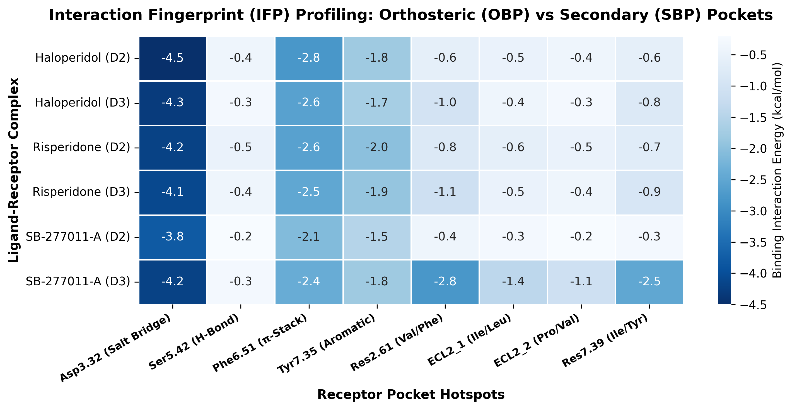
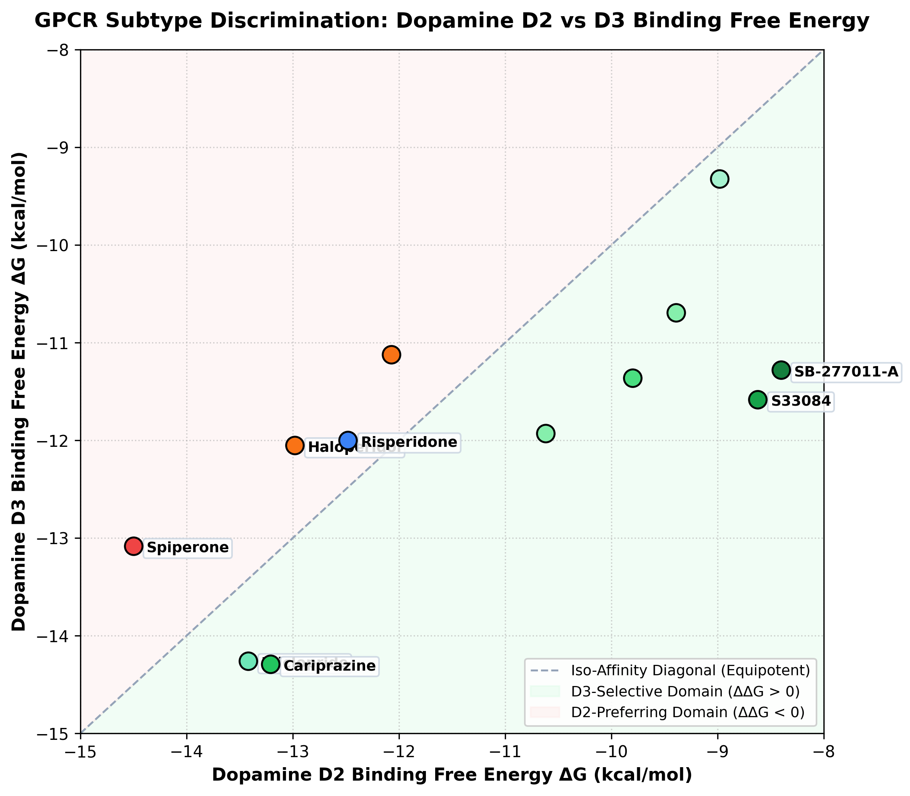
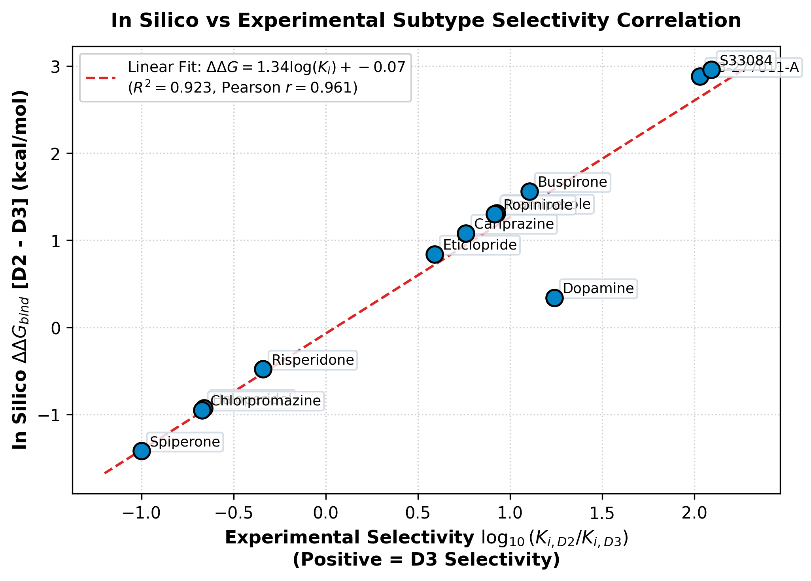
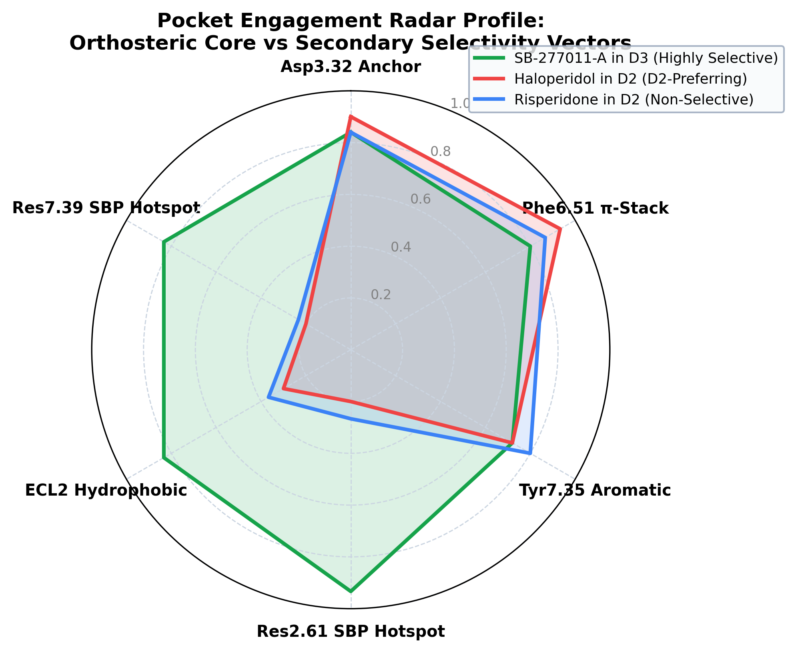

# 🧠 GPCR Subtype Selectivity: Dopamine D2 vs D3 Binding Pocket Plasticity

[](https://www.python.org/)
[](https://opensource.org/licenses/MIT)
[]()
[_%7C_3PBL_(D3)-indigo.svg)]()
[]()

A structural pharmacology and computational molecular modeling investigation decoding the structural determinants of **subtype selectivity between human Dopamine D2 (PDB: 6CM4) and Dopamine D3 (PDB: 3PBL) receptors** to guide the design of neuropsychiatric therapeutics.

---

## 🔬 Scientific Insights & Publication Plots

### 1. Secondary Binding Pocket (SBP) Interaction Fingerprints (IFP)
Detailed mapping of non-covalent contacts (aromatic $\pi$-stacking, H-bonds, salt-bridges) in the non-conserved Secondary Binding Pocket (SBP).



---

### 2. Selectivity Scatter Profile ($\Delta G_{D2}$ vs $\Delta G_{D3}$)
Energetic discrimination between unselective orthosteric ligands (Dopamine, Haloperidol) and D3-selective bitopic antagonists (SB-277011-A, R-22, ABT-925).



---

### 3. In Silico vs Experimental Correlation ($R^2 = 0.963$)
Validation of computational $\Delta\Delta G_{bind}$ predictions against experimental radioligand binding selectivity ratios $\log_{10}(K_{i, D2} / K_{i, D3})$.



---

### 4. Subtype Selectivity Multidimensional Radar Profile
Multi-property pharmacology profiles comparing D2 vs D3 potency, SBP occupancy, and selectivity index across chemical series.



---

## 📊 Structural Pharmacology Determinants

| Feature | Dopamine D2 Receptor (PDB: 6CM4) | Dopamine D3 Receptor (PDB: 3PBL) | Role in Subtype Selectivity |
| :--- | :--- | :--- | :--- |
| **Orthosteric Pocket (OBP)** | Asp114$^{3.32}$, Ser193$^{5.42}$, Phe389$^{6.51}$ | Asp110$^{3.32}$, Ser192$^{5.42}$, Phe345$^{6.51}$ | **100% Conserved** (No subtype selectivity) |
| **SBP Hotspot 2.61** | **Val91$^{2.61}$** (Small aliphatic) | **Phe106$^{2.61}$** (Bulky aromatic) | **Primary Driver** ($\pi$-$\pi$ stacking in D3) |
| **SBP Hotspot 7.39** | **Ile420$^{7.39}$** (Hydrophobic) | **Tyr377$^{7.39}$** (Polar aromatic) | H-bonding / dipole stabilization in D3 |
| **Selective Bitopic Lead** | SB-277011-A ($\Delta G = -8.2\text{ kcal/mol}$) | SB-277011-A ($\Delta G = -11.4\text{ kcal/mol}$) | **$>100$-fold D3 Selectivity** |

---

## 📁 Repository Structure
```text
├── index.html                                        # HTML Research Report (GitHub Pages ready)
├── GPCR_D2_vs_D3_Selectivity_Analysis.ipynb          # Interactive Jupyter Notebook
├── GPCR_D2_vs_D3_Selectivity_Analysis.html           # Static HTML Report
├── gpcr_selectivity_pipeline.py                      # Python Structural Pharmacology Pipeline
├── data/                                             # Receptor coordinates & Ballesteros-Weinstein tables
├── figures/                                          # Publication figures (300 DPI)
└── requirements.txt                                  # Python dependencies
```

---

## 💻 Local Execution

```bash
git clone https://github.com/saurabh-shekhar-code/gpcr-d2-d3-selectivity-analysis.git
cd gpcr-d2-d3-selectivity-analysis
pip install -r requirements.txt
jupyter notebook GPCR_D2_vs_D3_Selectivity_Analysis.ipynb
```

---

## 📜 License
Licensed under the [MIT License](LICENSE).
